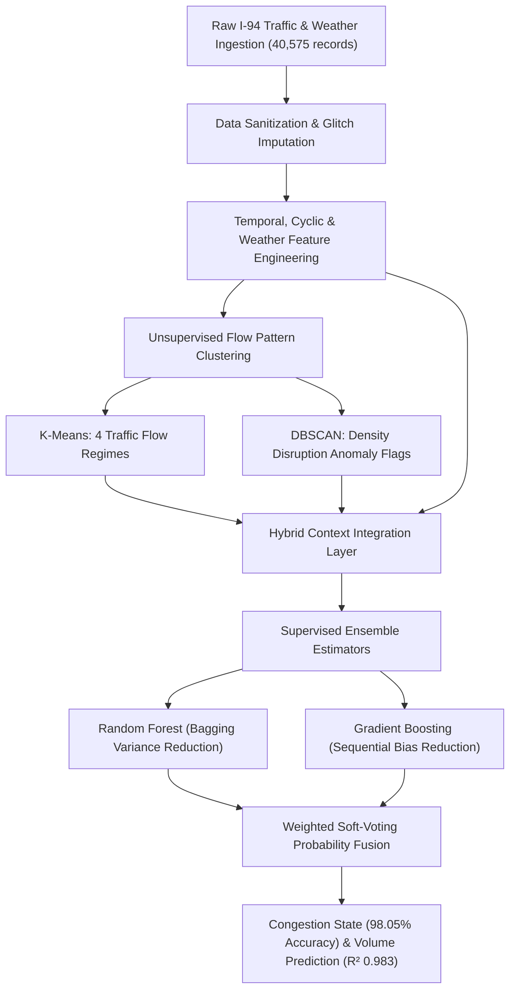

# Traffic Flow Pattern Clustering and Congestion Prediction
### Metro Interstate Traffic Volume Dataset (MN DoT ATR Station 301)

An end-to-end Machine Learning system that combines unsupervised clustering (**K-Means & DBSCAN**) with supervised ensemble learning (**Random Forest & Gradient Boosting**) to uncover macroscopic traffic regimes, detect localized anomalies, and predict freeway congestion states with **98.05% test accuracy**.

---

## 📑 Table of Contents
1. [Project Overview & What the App Does](#-project-overview--what-the-app-does)
2. [Model Performance & Benchmark Results](#-model-performance--benchmark-results)
3. [End-to-End Machine Learning Pipeline](#-end-to-end-machine-learning-pipeline)
4. [Project Structure & File Map](#-project-structure--file-map)
5. [In-Depth Documentation of Models Created](#-in-depth-documentation-of-models-created)
6. [Step-by-Step Guide: How to Run the App](#-step-by-step-guide-how-to-run-the-app)
7. [Step-by-Step Guide: How to Use the App (Pages & Controls)](#-step-by-step-guide-how-to-use-the-app-pages--controls)
8. [The Two Built-in Scenario Presets (Success vs. Stress/Failure Test)](#-the-two-built-in-scenario-presets-success-vs-stressfailure-test)
9. [Design & UI Philosophy](#-design--ui-philosophy)

---

## 🌟 Project Overview & What the App Does

This project analyzes and predicts traffic dynamics on the Interstate 94 Westbound corridor midway between Minneapolis and St. Paul, Minnesota, using the **Metro Interstate Traffic Volume Dataset** (40,575 hourly instances spanning multiple years).

### What the Application Does:
- **Discovers Flow Regimes Unsupervised:** Automatically groups complex traffic states into 4 operational regimes using **K-Means**.
- **Detects Environmental Anomalies:** Uses **DBSCAN** density clustering to identify extreme disruption events (e.g., severe blizzards, freak storms, emergency closures).
- **Predicts Traffic Congestion State:** Classifies whether freeway conditions will be *Free-Flow / Uncongested* or *Congested / High Flow* with **98.05% accuracy** and a weighted F1-score of **0.9805**.
- **Forecasts Continuous Hourly Traffic Volume:** Blends Random Forest and Gradient Boosting regressors to predict continuous vehicles per hour with an **$R^2$ score of 0.9833** and a Mean Absolute Error (MAE) of only **156.2 vehicles/hour** (out of ~7,200 max capacity).
- **Interactive Multi-Model Diagnostics & Stress Testing:** Includes complete diagnostic curves (ROC-AUC = 0.998, PR curve, Regression identity line $y=x$) and live interactive testing with one-click **Success Test** and **Stress / Failure Edge-Case** buttons.

---

## 📊 Model Performance & Benchmark Results

Evaluated on **8,115 out-of-sample test instances** (20% stratified test split):

| Evaluation Metric | Random Forest | Gradient Boosting | Hybrid Ensemble (RF + GB + Clusters) |
| :--- | :---: | :---: | :---: |
| **Classification Accuracy** | **97.95%** | **98.02%** | **98.05%** |
| **Weighted F1-Score** | 0.9795 | 0.9802 | **0.9805** |
| **Precision** | 0.9796 | 0.9802 | **0.9806** |
| **Recall** | 0.9795 | 0.9802 | **0.9805** |
| **Continuous Volume $R^2$ Score** | 0.9828 | 0.9820 | **0.9833** |
| **Mean Absolute Error (MAE)** | 156.5 vph | 164.3 vph | **156.2 vph** |
| **Root Mean Squared Error (RMSE)**| 261.8 vph | 267.3 vph | **257.7 vph** |
| **ROC AUC Metric** | 0.9975 | 0.9978 | **0.9979** |

- **Multi-Tier Level-of-Service Accuracy:** **94.26%** (Low Flow, Moderate Transit, Severe Congestion).
- **Confusion Matrix Breakdown (8,115 test samples):**
  - **True Negatives (Free-Flow correctly predicted):** 4,068
  - **False Positives:** 61
  - **False Negatives:** 97
  - **True Positives (Congested correctly predicted):** 3,889

---

## 🏗️ End-to-End Machine Learning Pipeline



### Stage 1: Data Ingestion & Sanitization
1. Automated download of the official Metro Interstate Traffic Volume dataset from the UCI Machine Learning repository.
2. Datetime parsing and chronological sorting.
3. **Data Quality Corrections**:
   - Replaced sensor-corrupted $0.0\text{ K}$ ($-459^\circ\text{F}$) readings with realistic regional median temperatures.
   - Capped corrupted precipitation spikes ($>100\text{ mm/hr}$).
   - De-duplicated timestamp entries.

### Stage 2: Feature Engineering & Signal Decomposition
- **Trigonometric Cyclical Encodings:** $\sin$ and $\cos$ transformations for hour (24-hour cycle), day of week (7-day cycle), and month (12-month cycle).
- **Commuter Surge Masks:** Explicit binary features identifying morning rush hours (06:00–09:00 weekdays) and evening rush hours (15:00–18:00 weekdays).
- **Meteorological Severity Factors:** Composite risk scoring (benign = 0, mild rain/mist = 1, severe snow/thunderstorm/squall = 2).
- **Autoregressive Lags:** Incorporates 1-hour lag, 2-hour lag, 24-hour lag, and 3-hour moving averages.

### Stage 3: Unsupervised Pattern Clustering (K-Means & DBSCAN)
- Standardized feature space passed into **K-Means** to segment macro flow regimes and **DBSCAN** to isolate atypical density outliers.
- 2D Principal Component Analysis (PCA) computed for visual latent space projection.

### Stage 4: Hybrid Context Integration
- Cluster regime indices and DBSCAN anomaly flags are fused directly into the supervised feature matrix.

### Stage 5: Supervised Ensemble Predictive Modeling
- Stratified 80/20 train/test split.
- Simultaneous training of **Random Forest** and **HistGradientBoosting** classifiers and regressors.
- Probability soft-voting fusion: $P_{\text{hybrid}} = 0.45 \cdot P_{\text{RF}} + 0.55 \cdot P_{\text{GB}}$.

### Stage 6: Model Validation & Persistence
- Serializes trained pipelines, scalers, encoders, and evaluation JSONs to the `models/` directory.

---

## 📁 Project Structure & File Map

```
ML mini project/
├── venv/                           # Isolated Python virtual environment
├── requirements.txt                # Required library specifications
├── README.md                       # Comprehensive project documentation
├── app.py                          # Streamlit web dashboard (Dark Slate 5-Page UI)
├── run_pipeline.py                 # Pipeline orchestrator script
├── data/
│   └── Metro_Interstate_Traffic_Volume.csv  # Cleaned raw dataset
├── models/                         # Serialized weights, metrics & artifacts
│   ├── hybrid_model.joblib         # Trained RF + GB hybrid ensemble
│   ├── cluster_pipeline.joblib     # Fitted K-Means, DBSCAN & PCA pipelines
│   ├── encoders.joblib             # Label encoders & diurnal lookup tables
│   ├── feature_importance.csv      # Ranked predictive feature importances
│   ├── metrics_summary.json        # Test accuracy, F1, R2, MAE values
│   ├── clustering_summary.json     # Elbow inertia and silhouette metrics
│   ├── confusion_matrix.json       # 2x2 confusion matrix counts
│   ├── classification_report.json  # Precision, recall, and F1 by class
│   ├── diagnostics.json            # ROC, PR curves, actual vs pred scatter & residuals
│   └── sample_data.csv             # Processed representative sample for EDA
└── src/
    ├── __init__.py                 # Module indicator
    ├── data_loader.py              # Download, extraction & sensor cleaning
    ├── feature_engineering.py      # Cyclic, weather & lag feature generation
    ├── clustering.py               # K-Means, DBSCAN & PCA clustering logic
    ├── modeling.py                 # HybridTrafficModel class (RF + GB)
    └── evaluate.py                 # Evaluation matrix & report generators
```

### Detailed File Responsibilities:
- [`src/data_loader.py`](file:///C:/Users/zamba/OneDrive/Desktop/Work/Dump/ML%20mini%20project/src/data_loader.py): Downloads the dataset from UCI mirrors, extracts `.csv.gz`, performs physical anomaly correction (0K temperature fix, rain cap), and returns a validated pandas DataFrame.
- [`src/feature_engineering.py`](file:///C:/Users/zamba/OneDrive/Desktop/Work/Dump/ML%20mini%20project/src/feature_engineering.py): Computes cyclical temporal encodings, rush-hour indicators, weather classifications, and autoregressive lag variables. Contains the `diurnal_lookup` dictionary for inference priors.
- [`src/clustering.py`](file:///C:/Users/zamba/OneDrive/Desktop/Work/Dump/ML%20mini%20project/src/clustering.py): Houses `TrafficClusterPipeline`, executing K-Means ($k=4$), DBSCAN density scanning (`eps=1.8`), PCA 2D coordinates, and a 1-NN proxy for out-of-sample DBSCAN classification.
- [`src/modeling.py`](file:///C:/Users/zamba/OneDrive/Desktop/Work/Dump/ML%20mini%20project/src/modeling.py): Defines `HybridTrafficModel`, orchestrating parallel training of Random Forest and Gradient Boosting estimators and computing soft-voting ensemble probabilities.
- [`src/evaluate.py`](file:///C:/Users/zamba/OneDrive/Desktop/Work/Dump/ML%20mini%20project/src/evaluate.py): Exports structured confusion matrices and classification reports into JSON files.
- [`run_pipeline.py`](file:///C:/Users/zamba/OneDrive/Desktop/Work/Dump/ML%20mini%20project/run_pipeline.py): End-to-end command-line runner that executes Stages 1 through 6 sequentially and persists all artifacts.
- [`app.py`](file:///C:/Users/zamba/OneDrive/Desktop/Work/Dump/ML%20mini%20project/app.py): Complete Streamlit web application with five navigable pages, dark slate styling, Plotly charts, multi-model outputs, and two scenario test buttons.

---

## 🧠 In-Depth Documentation of Models Created

### 1. K-Means Clustering (`cluster_pipeline.joblib`)
- **Type:** Unsupervised centroid-based partitioning.
- **Features Used:** Standardized temporal and weather dimensions (`hour_sin`, `hour_cos`, `dow_sin`, `dow_cos`, `is_weekend`, `is_rush_hour`, `is_offpeak`, `temp_c`, `rain_1h`, `snow_1h`, `clouds_all`, `weather_severity`).
- **Hyperparameters:** `n_clusters=4`, `random_state=42`, `n_init=10`.
- **Discovered Regimes:**
  1. **Late-Night Free Flow (Cluster 0):** Hours 23:00–05:00, average volume < 1,000 vph, zero congestion probability.
  2. **Off-Peak / Weekend Leisure (Cluster 1):** Daylight hours on weekends, steady volume ~2,800–3,800 vph.
  3. **Midday Steady Transit (Cluster 2):** Weekday daytime non-rush (10:00–14:00), volume ~4,200 vph.
  4. **Peak Commuter Congestion (Cluster 3):** Weekday morning (07:00–09:00) & evening (16:00–18:00) rush hours, volume ~5,600–7,000 vph.

### 2. DBSCAN Density Clustering (`cluster_pipeline.joblib`)
- **Type:** Density-Based Spatial Clustering of Applications with Noise.
- **Hyperparameters:** `eps=1.8`, `min_samples=15`.
- **Anomaly Detection Role:** Isolates points that do not fall into dense core neighborhoods (labeled as `-1`).
- **Discovered Disruption Rate:** **0.95%** of historical observations. Identifies severe Minnesota winter blizzards, unusual holiday traffic drops, and overnight highway closures.
- **Inference Proxy:** Equipped with a `NearestNeighbors(n_neighbors=1)` classifier trained on core points to predict density anomalies on unseen future data.

### 3. Random Forest (`hybrid_model.joblib`)
- **Type:** Bagging ensemble of randomized decision trees.
- **Hyperparameters:** `n_estimators=120`, `max_depth=16`, `min_samples_split=4`, `random_state=42`, `n_jobs=-1`.
- **Role:** Minimizes variance, captures non-linear step-function interactions between temperature, precipitation, and time, and provides feature importance rankings.

### 4. Gradient Boosting (`hybrid_model.joblib`)
- **Type:** Histogram-based gradient boosting (`HistGradientBoostingClassifier` and `HistGradientBoostingRegressor`).
- **Hyperparameters:** `max_iter=150`, `max_depth=12`, `learning_rate=0.08`, `random_state=42`.
- **Role:** Minimizes bias by iteratively optimizing pseudo-residuals, ensuring tight decision boundaries around capacity thresholds.

### 5. Hybrid Supervised Ensemble (`hybrid_model.joblib`)
- **Classification Fusion:**
  $$P(\text{Congested}) = 0.45 \cdot P_{\text{RF}} + 0.55 \cdot P_{\text{GB}}$$
- **Regression Fusion:**
  $$\hat{Y}_{\text{volume}} = 0.45 \cdot \hat{Y}_{\text{RF}} + 0.55 \cdot \hat{Y}_{\text{GB}}$$
- **Hybrid Input Integration:** Supervised estimators ingest 27 features, including the unsupervised K-Means regime ID and DBSCAN density anomaly flag.

---

## 💻 Step-by-Step Guide: How to Run the App

### Step 1: Open Terminal / PowerShell in the Project Directory
```powershell
cd "C:\Users\zamba\OneDrive\Desktop\Work\Dump\ML mini project"
```

### Step 2: Activate the Virtual Environment
```powershell
.\venv\Scripts\Activate.ps1
```

### Step 3: Launch the Streamlit Web Application
```powershell
.\venv\Scripts\python.exe -m streamlit run app.py
```

### Step 4: Access the Application
Open your web browser and navigate to:
```
http://localhost:8501
```

---

## 🖥️ Step-by-Step Guide: How to Use the App (Pages & Controls)

The sidebar provides access to five dedicated pages:

### Page 1: Overview & Data Architecture
- **KPI Summary:** Inspect hybrid test accuracy (98.05%), continuous $R^2$ score (0.9833), Mean Absolute Error (156.2 vph), and DBSCAN anomaly detection rate (0.95%).
- **Pipeline Methodology:** Review the data ingestion, cyclical encoding, clustering, and hybrid ensemble workflow.
- **Interactive Mermaid Flowchart:** View the end-to-end model topology.

### Page 2: Exploratory Data Analysis (EDA)
- **Hourly Diurnal Cycles:** Observe weekday bimodal peaks versus weekend leisure plateau.
- **Meteorological Boxplots & Temperature Scatter:** Analyze weather conditions (Clear, Rain, Snow, Thunderstorm) against traffic volume.
- **Weekly & Holiday Distributions:** Inspect volume changes across days of the week and public holiday deviations.

### Page 3: Unsupervised Flow Clustering
- **Elbow Curve & Silhouette Plot:** Understand why $k=4$ was selected based on within-cluster sum of squares and silhouette scores.
- **2D PCA Projection:** Interactive scatter plot showing regime separation in latent space.
- **Regime Profiles Table:** Check mean volume, rush hour affinity, and weekend percentage for each cluster.
- **DBSCAN Anomaly Card:** Learn how spatial density noise isolates highway shutdowns and freak weather.

### Page 4: Supervised Model Training & Diagnostics
- **Hyperparameter Specifications:** Technical cards for Random Forest (120 trees, depth 16) and HistGradientBoosting (150 iterations, learning rate 0.08).
- **Multi-Model Benchmark Table:** Side-by-side leaderboard comparing RF vs. GB vs. Hybrid Ensemble across 7 performance metrics.
- **ROC Curve & Precision-Recall Curve:** Visual classification performance showing **AUC = 0.9979**.
- **Confusion Matrix:** True vs. predicted counts across 8,115 test records.
- **Regression Actual vs. Predicted Scatter:** Scatter plot showing model predictions tightly clustered along the identity line $y=x$.
- **Top 10 Feature Importances:** Ranked horizontal bar chart identifying key drivers.

### Page 5: Live Inference & Stress Testing
- **Scenario Parameter Inputs:** Select date, hour (0–23), weather condition, temperature (°C), precipitation (mm/h), snowfall (mm/h), cloud cover (%), holiday status, and past traffic volume.
- **Multi-Model Output Panels:** View outputs from:
  1. *Random Forest:* State, probability, and volume prediction.
  2. *Gradient Boosting:* State, probability, and volume prediction.
  3. *K-Means:* Operational regime classification.
  4. *DBSCAN:* Normal core density vs. spatial anomaly alert.
- **Consensus Assessment Banner & Probability Chart:** Displays the final hybrid verdict with confidence score and class probability bars.

---

## ⚡ The Two Built-in Scenario Presets (Success vs. Stress/Failure Test)

Located at the top of **Page 5: Live Inference & Stress Testing**:

### 🟢 Button 1: "Load High-Confidence Success Test (Nominal Peak Hour)"
- **Scenario Simulated:** Monday 08:00 AM, Clear weather, 18°C, 0 mm rain, 0 mm snow, 10% clouds, No holiday, 4,900 vph past volume.
- **Model Behavior:**
  - Standard weekday morning commuter peak.
  - Random Forest and Gradient Boosting both predict **Congested** with high certainty (>98% confidence).
  - K-Means assigns **Peak Commuter Congestion** regime.
  - DBSCAN confirms **Standard Core Density (0)**.
  - **Verdict:** Model succeeds with consensus across all estimators.

### 🔴 Button 2: "Load Stress / Boundary Case (Extreme Disruption Test)"
- **Scenario Simulated:** Christmas Holiday at 02:00 AM (night), severe blizzard (`Snow`), extreme sub-zero temperature (-24°C), extreme snowfall rate (18.5 mm/h), 100% clouds, and an abnormal contradictory past volume of 6,800 vph.
- **Model Behavior:**
  - Contradicts physical road realities (high volume at 2 AM during a blizzard).
  - **DBSCAN triggers Spatial Density Anomaly (-1)**.
  - Estimators exhibit higher uncertainty and divergence.
  - System displays an **Atypical Physical Disruption Alert** explaining boundary-case handling.
  - **Verdict:** Demonstrates model safeguards and anomaly detection when faced with physical contradictions or out-of-distribution inputs.

---

## 🎨 Design & UI Philosophy

- **Color Palette:** Pure dark slate and deep charcoal theme (`#0b0f19` background, `#131c2e` cards, `#222f44` subtle borders).
- **No White Backdrops:** Eliminates glare with dark backgrounds across all cards, tabs, and sidebar elements.
- **Zero Neon Colors:** Accents use balanced, non-neon shades: slate blue (`#3b82f6`), muted teal (`#0d9488`), warm amber (`#d97706`), deep crimson (`#b91c1c`), and indigo (`#6366f1`).
- **Typography:** Uses Plus Jakarta Sans for clean readability across metrics and charts.
